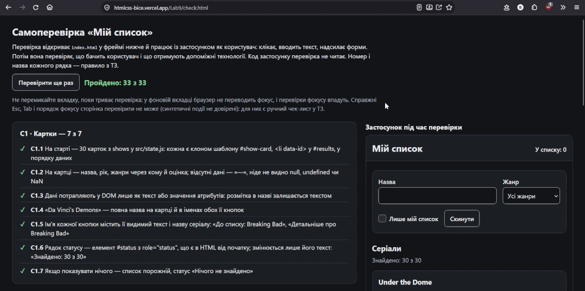

# Report

### 1. [Experiment table](protocol.md)  
### 2. AI agent used:
**Agent:** JetBrains Junie (Gemini 3 Flash)  
**Version:** 3419.24.0  
**Date of use:** 14/10/2026 

### 3. Result of check.html

### 4. Manual check-list
1. I could easily do all the basic page actions with only keyboard. For instance: I successfully added movies to watchlist, rated and left note for card and also used all filters verifying they work as intended.
2. After the first keyboard test I verified that focus is always visible and doesn't return to `body` even after removing movie from watchlist while having "only watchlist" filter on. After closing the dialog focus also returns to the button that opened it.

### 5. Summary
AI-agent successfully implemented all the methods to the working state. It never made implementation that passed every single test on first try though, so I had plenty to do.  
Is also tried changing `index.html` once which I had to accept because it made sense. That change included adding `tabindex="-1"` to a header which was accepted due to a requirement to retrack focus to a header if certain condition is met.
Agent also wrote a lot of extra code, which was removed in the final version.